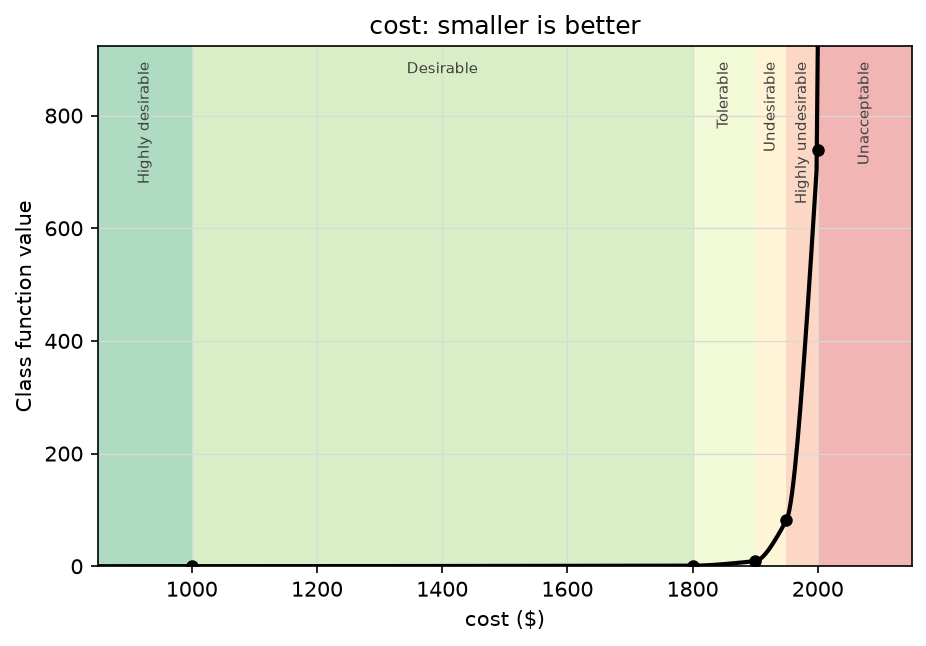
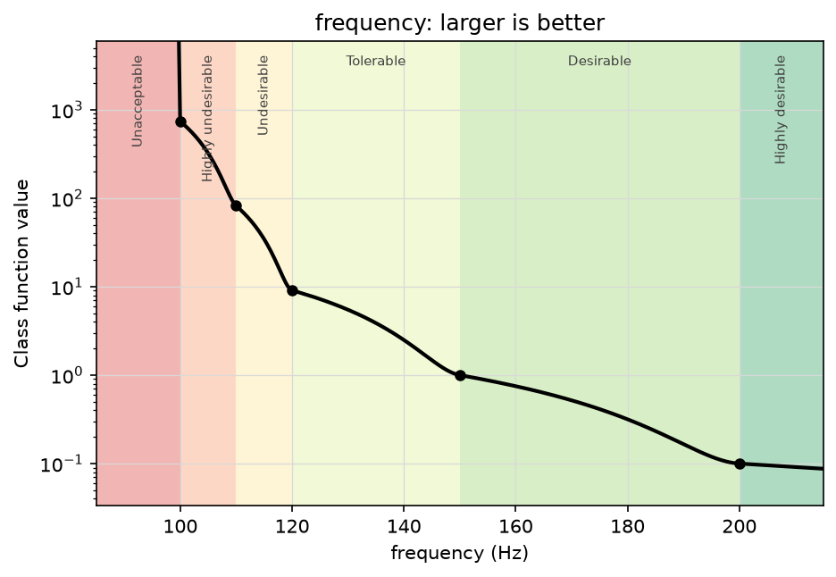
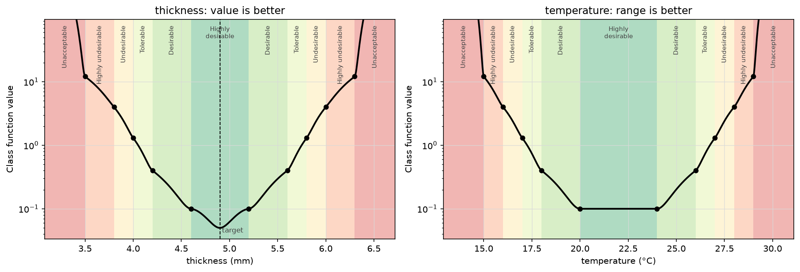
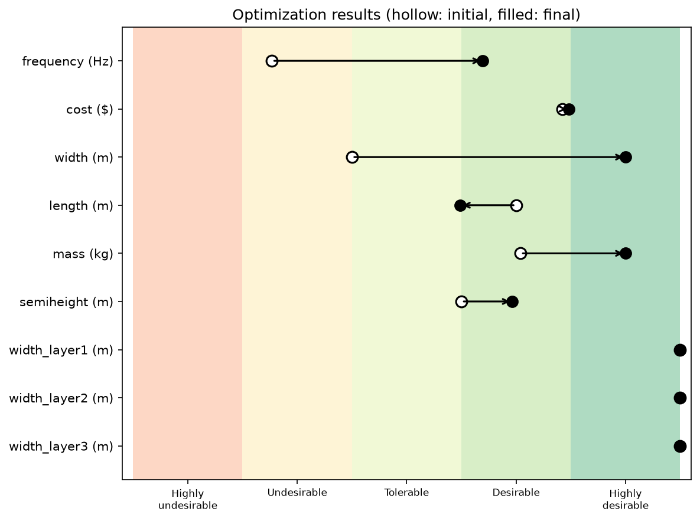
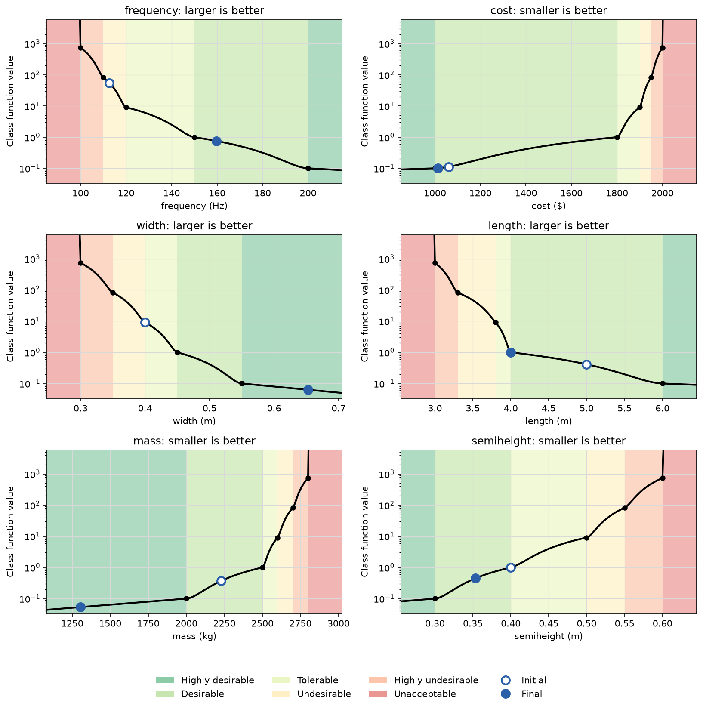

# PhysProg

[](https://github.com/partofthething/physprog/actions/workflows/ci.yml)

**physprog** ("Physical Programming") is a tool for people who have something
with multiple metrics they want to optimize simultaneously. You may be an
engineer wanting to minimize the cost, minimize the weight, and maximize the
width of a widget. Or you may be a fund manager trying to maximize
your up-market capture ratio while minimizing your down-market capture ratio.

Regardless of what you want to optimize, it's often a dark art to weight
multiple performance metrics into one aggregate objective function to be passed
off to a general purpose function minimizer.

**physprog** eliminates the guess-work by taking meaningful preferences for each
performance metric and building the
aggregate objective function for you. With this, you can focus your time on
adjusting the design of your product and less time (no time, really)
adjusting the weights so that they accurately reflect your preferences.

**physprog** is an implementation of the Messac's Physical Programming algorithm
[[1](https://messac.expressions.syr.edu/wp-content/uploads/2012/05/Messac_1996_AIAA_PP.pdf)].
For each performance metric, you express your preferences by defining the
boundaries between 6 preference regions:

* Highly Desirable
* Desirable
* Tolerable
* Undesirable
* Highly Undesirable
* Unacceptable

You can choose between several *class functions* to reflect these
preferences, such as:

* Smaller is better (`SmallerBetter`)
* Larger is better (`LargerBetter`)
* Value is better (`ValueIsBetter`)
* Range is better (`RangeIsBetter`)

Of course, you can also define hard constraints for
performance metrics, as in: "thickness has to be at least 1mm"
(`MustBeBelow`, `MustBeAbove`, `MustEqual`, `MustBeInRange`).

**physprog** can just hand you the objective function for you to pass on
to whatever optimization routine you prefer, or it has some basic
code to pass it through [scipy.optimize.minimize](https://docs.scipy.org/doc/scipy/reference/generated/scipy.optimize.minimize.html#scipy.optimize.minimize)
and do the full optimization for you.

The code for this project, as well as the issue tracker, etc. is
[hosted on GitHub](https://github.com/partofthething/physprog)

# Installing it

Install directly from the repo:

    uv pip install git+https://github.com/partofthething/physprog.git

Or from a local clone:

    git clone git@github.com:partofthething/physprog.git
    cd physprog
    uv pip install .

# Development

    git clone git@github.com:partofthething/physprog.git
    cd physprog
    uv sync
    uv run pytest

# Using it

To use **physprog** you need two things: your preferences and a model.

## Specifying Preferences

You specify your preferences in a YAML input file. The bounds input
should go from most desirable to least desirable, where anything
beyond the last bound is unacceptable. Here's an example:

```yaml
dependents:
  - name: frequency
    class: LargerBetter
    units: Hz
    bounds:
       - 200.0
       - 150.0
       - 120.0
       - 110.0
       - 100.0
  - name: cost
    class: SmallerBetter
    units: $
    bounds:
       - 1000.0
       - 1800.0
       - 1900.0
       - 1950.0
       - 2000.0
  - name: width
    class: MustBeAbove
    units: m
    bound: 0.01
```

For metrics that are bad on both sides, give `lower_bounds` (below the ideal,
decreasing) and `upper_bounds` (above the ideal, increasing), each from most
to least desirable. The highly desirable region is between the two first
bounds. `ValueIsBetter` takes an optional `target` inside that region (the
middle by default) and an optional `pull` from 0 to 1 (default 0.5) that sets
how strongly the target attracts the design. A two-sided hard
constraint takes a `[lower, upper]` pair:

```yaml
  - name: thickness
    class: ValueIsBetter
    units: mm
    target: 4.9
    pull: 0.5
    lower_bounds: [4.6, 4.2, 4.0, 3.8, 3.5]
    upper_bounds: [5.2, 5.6, 5.8, 6.0, 6.3]
  - name: temperature
    class: RangeIsBetter
    units: °C
    lower_bounds: [20, 18, 17, 16, 15]
    upper_bounds: [24, 26, 27, 28, 29]
  - name: angle
    class: MustBeInRange
    units: deg
    bounds: [10, 20]
```

`MustEqual` (a hard "value is better") takes a single `bound`, like
`MustBeAbove`:

```yaml
  - name: span
    class: MustEqual
    units: m
    bound: 4.0
```

NOTE: You can also build preferences in Python and bypass the input file.
Construct the class functions, put them in a dict keyed by dependent-variable
name, and call `classfunctions.build_all_splines(prefs.values())`.

## Visualizing class functions

Each soft preference becomes a smooth, convex *class function*. Its value at
each boundary is the same for every metric, so a metric that is just barely
"tolerable" costs the aggregate objective the same whether it is measured in
dollars, hertz or meters. Each step into a worse region costs much more than
all better regions of every other metric combined (the "one vs. others" rule).
Past the last bound, the function keeps rising smoothly with a quadratic
penalty.

```python
from physprog import classfunctions

preferences = classfunctions.from_input("input.yaml")
preferences["cost"].plot()  # or plot(fname='cost.png')
```





The black dots mark the region boundaries. Class functions are convex, but
each region's values are several times the previous region's, so on a linear
axis (as here) the better regions sit nearly flat near zero. Pass
`yscale="log"` (the default for the plot functions) to see every region
clearly. A log axis makes the convex curves look bulged between the bounds,
as in the grid of sample class functions further down.

Two-sided preferences join a larger-is-better curve and a smaller-is-better
curve around the highly desirable region. *Value is better* dips to
a minimum at the target. *Range is better* is flat across its whole range:



`pull` is how far the target dips below the edges of the highly desirable
region, as a fraction of the value there. With `pull: 0`, any value in the
region is about equally good, so the optimizer will happily drift to an edge
(or past it) to help other metrics. With the default 0.5, the target holds up
much better against competing metrics, though a metric that is still only
"desirable" can pull it slightly off target, as the one-vs-others rule
intends.

## Specifying a model

Your model must take inputs and produce outputs. Inputs should be
defined in a tuple or list in the same order that your preferences were
specified in. Outputs corresponding to inputs should be computed
by an `evaluate` method. There should be a method named after each of
your dependent variables. With the example preferences above, your model
may look like:

```python
SampleDesign = namedtuple("SampleDesign", ["d1", "d2", "d3", "b", "L"])


class SampleProblemBeam:
    """Dummy sample problem."""

    def __init__(self):
        self._design = SampleDesign(0.3, 0.35, 0.40, 0.40, 5.0)  # initial

    def evaluate(self, x=None):
        """Convert input design into output design parameters."""
        if x is not None:
            self.design = x
        return [self.frequency(), self.cost(), self.width()]

    def frequency(self):
        return math.pi / (2 * self.design.L**2) * self.design.d2

    def cost(self):
        ds = self.design
        return 2 * ds.b * ds.L

    def width(self):
        return self.design.b
```

A complete sample problem involving the design of a beam is [included
in the tests](./physprog/tests/test_sample_problem.py).


## Running an optimization problem

To compute the optimal design of your thing,
do something like this:

```python
from physprog import classfunctions, optimize

preferences = classfunctions.from_input("input.yaml")
model = SampleProblemBeam()
result = optimize.optimize(model, preferences, plot=True)
```

`optimize` returns the `scipy.optimize.OptimizeResult` and leaves `model` at
the optimal design. The plot shows where each metric started and ended on the
preference scale. Here are the results for the full sample problem:



You can also see the before/after design on each class function:

```python
from physprog import plots

initial = {name: getattr(model, name)() for name in preferences}  # before optimizing
# ... optimize ...
final = {name: getattr(model, name)() for name in preferences}
plots.plot_class_functions(preferences, initial, final)
```



This grid uses a log y axis so the shapes in every region are visible.

The README figures are regenerated with `uv run python scripts/make_readme_plots.py`.

## Building the objective function

If you just want an aggregate objective function without optimizing,
you can do this:

```python
from physprog import classfunctions, objective

preferences = classfunctions.from_input("input.yaml")
model = SampleProblemBeam()
aggregate = objective.build_objective(model, preferences)
```

Then you can pass the `aggregate` to any other optimization engine.

Hard constraints (`MustBeBelow`, `MustBeAbove`, `MustEqual`, `MustBeInRange`)
are not part of the aggregate objective, so pass them to your optimizer
separately. If your model is expensive, share a `ModelEvaluator` between the
objective and the constraints. It runs `model.evaluate(x)` once per design
and caches the results, so the objective, the constraints and their
finite-difference gradients don't re-run the model at the same point. For
scipy:

```python
import scipy.optimize
from physprog import objective, optimize

evaluator = objective.ModelEvaluator(model, preferences)
aggregate = objective.build_objective(model, preferences, evaluator=evaluator)
constraints = optimize.get_constraints(model, preferences, evaluator=evaluator)
result = scipy.optimize.minimize(aggregate, model.design, constraints=constraints)
```

# Contributing

You are encouraged to make contributions to make this system more
useful to everyone. There are automated tests that run with
`uv run pytest` so make sure those all pass before submitting a PR.
You can run the linter with `uv run ruff check .` and the formatter
with `uv run ruff format .`. If you have a big change in mind you
may want to contact the author.

# License

This package is released under the Apache-2.0 license [reproduced
here](./LICENSE).

# References and See Also

1. Messac, A. (1996). 
   [Physical programming—Effective optimization for computational design.](https://doi.org/10.2514/3.13035) *AIAA Journal*, *34*(1), 149-158.
2. Touran, N. W. (2012). 
   [A modal expansion equilibrium cycle perturbation method for optimizing high burnup fast reactors](https://deepblue.lib.umich.edu/items/661bf746-f4a8-4268-b1d9-756551016636) (Doctoral dissertation, University of Michigan).
3. Wikipedia contributors. (n.d.). 
   [Multi-objective optimization](https://en.wikipedia.org/wiki/Multiobjective_optimization) 
   In *Wikipedia, The Free Encyclopedia*.